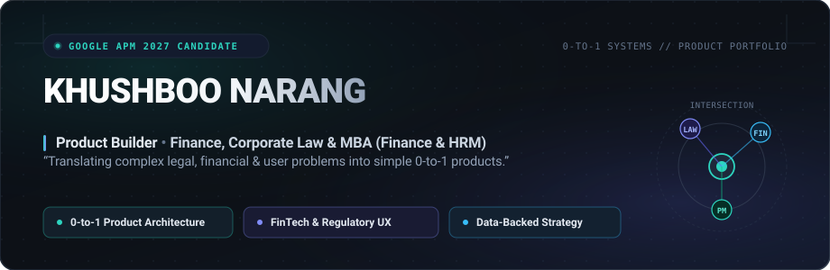

<div align="center">

<!-- Hero Banner -->


<br/>

<!-- Quick Connect & Status Badges -->
<p align="center">
  <a href="https://www.linkedin.com/in/khushboonarang447775261" target="_blank">
    
  </a>
  &nbsp;
  <a href="mailto:khushboonarang06@gmail.com">
    
  </a>
  &nbsp;
  
  &nbsp;
  
</p>

</div>

---

### ✦ Product Executive Summary

> **"Most products fail not from lack of code, but from an inability to translate opaque statutory rules, messy financial constraints, and high-stress user anxiety into intuitive software."**

I am a **0-to-1 Product Builder** with a multi-disciplinary foundation across **Finance, Corporate Law, and MBA (Finance & HRM)**. I design systems that simplify complex domains—from building rapid cyber-fraud recovery workflows adhering to Reserve Bank of India (RBI) mandates, to scaling community-driven learning platforms for 100k+ finance aspirants alongside top creators.

Currently channeling rigorous analytical rigor, user empathy, and rapid prototyping toward the **Google Associate Product Manager (APM) 2027** cohort.

---

## ⚡ Featured 0-to-1 Product Builds

<br/>

### 1. RECLAIM — Guided Cyber-Fraud Recovery Web App
*Zero-to-one product engineered for rapid digital banking & UPI fraud restitution.*

<div align="center">
  
</div>

<br/>

* **The Core User Problem:**
  Victims of digital banking fraud operate in a state of acute panic. They face high cognitive load, fragmented bank toll-free numbers, and opaque 72-hour Reserve Bank of India (RBI) statutory deadlines for zero-liability protection. Over 80% fail to file the statutory evidence required within the golden window.
* **Key Product Decisions & Architecture:**
  * **Dual-Path Onboarding:** Split user entry into **Panic Mode** (1-click account/UPI freeze guidance in `< 60 seconds`) vs. **Structured Filing** (comprehensive evidence collection).
  * **4W Precision Engine:** Deconstructs traumatic incidents into structured metadata (*What* happened, *When* it transpired, *Where* money moved, and *Who* was communicated with) without legal jargon.
  * **Plain-Language RBI Rules:** Translates the RBI *Charter of Customer Rights* and Master Circulars into calm, step-by-step reporting guidance without countdown timers to prevent user panic, paired with auto-generated statutory claim letters.
  * **Amount-Based Smart Routing:** Dynamically routes complaints between Bank Nodal Grievance cells, MoHA Cyber Cell (1930 portal), and the Reserve Bank Integrated Ombudsman Scheme based on transaction value and elapsed hours.

---

### 2. AIM4AIR — CMA Learning & Opportunity Ecosystem
*Comprehensive study, mentorship, and articleship hub for Cost & Management Accounting aspirants.*

<div align="center">
  
</div>

<br/>

* **The Core User Problem:**
  CMA candidates across tier-1 to tier-3 India lack a cohesive, structured platform for curriculum tracking, verified resources, and articleship placement. Aspirants juggle fragmented WhatsApp/Telegram groups, unverified notes, and opaque corporate hiring pipelines.
* **Key Product Decisions & Architecture:**
  * **Creator-to-Product Flywheel:** Partnered with premier finance creator **Vinayak** to convert 100,000+ organic video viewers into a structured, highly engaged product user base.
  * **Structured Milestone Architecture:** Engineered curriculum tracking mapped directly to ICMAI exam syllabi (Foundation, Intermediate, Final), reducing drop-off through bite-sized progression bars.
  * **Articleship & Opportunity Engine:** Designed a discovery interface connecting qualified students directly with corporate training opportunities and verified alumni mentors.
  * **Centralized Curated Repository:** Unified statutory tax amendments, mock test analysis, and peer discussion boards into a clean, noise-free web environment.

---

### 3. EVALORA AI — Finance Intelligence Prototype
*AI-driven financial statement synthesis and dynamic ratio intelligence for non-technical leaders.*

<div align="center">
  
</div>

<br/>

* **The Core User Problem:**
  Founders, operational managers, and non-finance product leaders struggle to extract strategic signals from dense Balance Sheets, P&L statements, and Cash Flow disclosures, leading to reactive financial planning.
* **Key Product Decisions & Architecture:**
  * **Interactive Ratio Analysis Engine:** Implemented automated calculations for DuPont ROE decomposition, current/quick liquidity buffers, and Altman Z-score solvency stress tests.
  * **Automated Statement Workflows:** Designed a lightweight parsing pipeline that converts raw balance sheet tables into standardized financial categories.
  * **Plain-Language Executive Synthesis:** Generates human-readable narrative summaries highlighting operating runway, working capital bottlenecks, and debt covenant risks.
  * **Visual Financial Health Matrix:** Replaced wall-of-numbers spreadsheets with intuitive color-coded risk gauges, sensitivity sliders, and multi-quarter margin trends.

---

## 💼 Founder's Office & Strategy Experience

<table width="100%" border="0" cellpadding="8" cellspacing="0">
  <tr valign="top">
    <td width="33%">
      <h4>🏢 Office of Vinayak</h4>
      <p><strong>Research, Strategy &amp; Founder's Office Collaborator</strong></p>
      <ul>
        <li>Partnered directly with the founder on 0-to-1 ecosystem ideation, content strategy, and community roadmap planning for 100k+ audience.</li>
        <li>Conducted user discovery interviews with finance students to define user friction points, curriculum bottlenecks, and product requirements.</li>
        <li>Spearheaded research synthesis on CMA trends, edtech distribution models, and strategic partnerships.</li>
      </ul>
    </td>
    <td width="33%">
      <h4>📈 NoviTech R&amp;D</h4>
      <p><strong>Data Analytics &amp; Market Research</strong></p>
      <ul>
        <li>Analyzed structured datasets to derive behavioral user patterns, engagement metrics, and growth levers.</li>
        <li>Built dynamic dashboards and quantitative tracking systems to evaluate performance benchmarks.</li>
        <li>Synthesized multi-source competitive research into actionable product recommendations.</li>
      </ul>
    </td>
    <td width="33%">
      <h4>🚀 iDigitalPreneur</h4>
      <p><strong>Digital Marketing &amp; Growth Strategy</strong></p>
      <ul>
        <li>Executed growth experiments and digital funnel optimization to drive learner acquisition and retention.</li>
        <li>Analyzed audience conversion funnels, landing page drop-offs, and campaign attribution metrics.</li>
        <li>Designed community engagement playbooks to nurture active cohorts.</li>
      </ul>
    </td>
  </tr>
</table>

---

## 🛠️ How I Build & Analyze

<table width="100%" border="0" cellpadding="10" cellspacing="0">
  <thead>
    <tr align="left" style="background-color: #161B22;">
      <th width="33%">🎨 Product &amp; UX</th>
      <th width="33%">📊 Data, Finance &amp; Law</th>
      <th width="33%">⚙️ Systems &amp; Execution</th>
    </tr>
  </thead>
  <tbody>
    <tr valign="top">
      <td>
        • <strong>User Discovery &amp; JTBD</strong> (Jobs-to-be-Done)<br/>
        • <strong>Information Architecture</strong> &amp; User Journeys<br/>
        • <strong>Rapid Prototyping &amp; Wireframing</strong><br/>
        • <strong>MVP Scoping</strong> &amp; PRD Documentation<br/>
        • <strong>AI-Assisted Prototyping</strong> (LLM Workflows)<br/>
        • <strong>Usability Testing</strong> &amp; Feedback Loops
      </td>
      <td>
        • <strong>Financial Statement Analysis</strong> (P&amp;L, B/S, CFS)<br/>
        • <strong>Corporate Law &amp; Regulatory Compliance</strong><br/>
        • <strong>Advanced Excel Modeling</strong> &amp; Sensitivity Testing<br/>
        • <strong>Power BI &amp; Interactive Dashboards</strong><br/>
        • <strong>RBI Banking Regulations</strong> &amp; Consumer Rights<br/>
        • <strong>Tally ERP</strong> &amp; Corporate Accounting Systems
      </td>
      <td>
        • <strong>Notion Product Operating Systems</strong><br/>
        • <strong>Cross-Functional Alignment</strong> &amp; Stakeholder Mgmt<br/>
        • <strong>Market Synthesis</strong> &amp; Competitive Moats<br/>
        • <strong>Funnel Optimization</strong> &amp; Cohort Retention<br/>
        • <strong>Structured Problem Solving</strong> (First Principles)<br/>
        • <strong>Execution Cadence</strong> in Founder's Office
      </td>
    </tr>
  </tbody>
</table>

---

## 🎯 The Google APM Perspective: Why This Intersection Matters

```
               ┌────────────────────────────────────────────────────────┐
               │            KHUSHBOO'S PRODUCT INTERSECTION             │
               └────────────────────────────────────────────────────────┘
                       ▲                           ▲
                       │                           │
          ┌────────────┴────────────┐ ┌────────────┴────────────┐
          │   FINANCE & ECONOMICS   │ │     CORPORATE LAW       │
          │   Unit Economics, LTV/  │ │   Statutory Compliance, │
          │   CAC, Capital Flow &   │ │   Data Privacy, Moats & │
          │   Business Viability    │ │   Consumer Protection   │
          └────────────┬────────────┘ └────────────┬────────────┘
                       │                           │
                       ▼                           ▼
               ┌────────────────────────────────────────────────────────┐
               │              0-TO-1 PRODUCT CRAFTSMANSHIP              │
               │   Empathy-driven UX, High-scale Systems & Execution    │
               └────────────────────────────────────────────────────────┘
```

1. **Regulatory Awareness as a Product Moat:** 
   Building at Google scale requires knowing that regulations (GDPR, DPDP, antitrust, financial compliance) are not afterthoughts—they define product architecture from Day 1.
2. **Economic Viability Built-in:** 
   My MBA in Finance enables me to ground feature prioritization in sustainable unit economics, operational feasibility, and tangible ROI.
3. **High-Empathy User Discovery:** 
   Whether it is an individual in financial distress after cyber-fraud or a student preparing for professional exams, my product intuition begins by deconstructing human psychology and anxiety.

---

## 📬 Let's Connect & Build

I am actively networking with product leaders, builders, and the **Google APM** community.

<p align="left">
  <a href="https://www.linkedin.com/in/khushboonarang447775261">
    
  </a>
  &nbsp;
  <a href="mailto:khushboonarang06@gmail.com">
    
  </a>
</p>

<p align="left">
  <sub>Crafted with precision for <strong>Khushboo Narang</strong> • © 2026/2027 • Targeting Google APM</sub>
</p>
