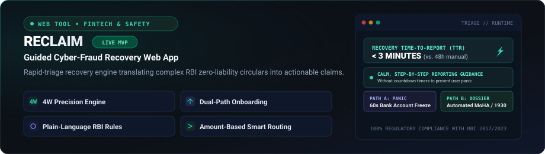
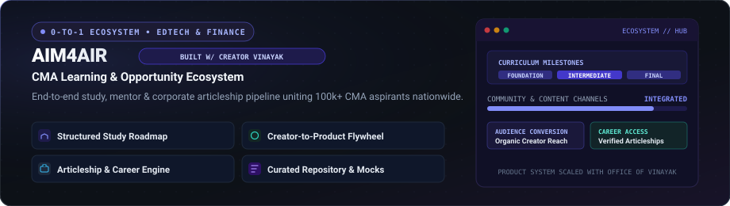
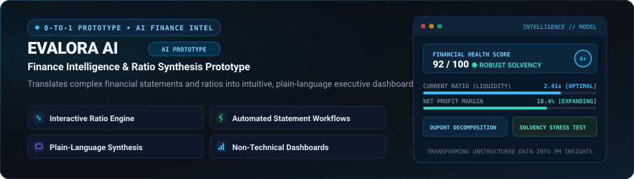

<!-- Hero Banner -->

 

<!-- Quick Connect & Status Badges -->

  
  &nbsp;
  
  &nbsp;
  
  &nbsp;
  

---

### ✦ Overview

> **"Great tools are built by translating opaque statutory rules, complex financial workflows, and user needs into simple, intuitive web solutions."**

I have an academic foundation across **Commerce, Corporate Law, and an MBA in Finance & HRM**. I enjoy building practical web tools that demystify complex subjects—from designing guided cyber-fraud recovery workflows adhering to Reserve Bank of India (RBI) mandates, to structuring learning and resource hubs in collaboration with finance creators.

I combine analytical rigor in corporate finance and legal frameworks with hands-on web prototyping, research synthesis, and creator ecosystem collaborations.

---

## ⚡ Practical Web Tools & Projects

 

### 1. RECLAIM — Guided Cyber-Fraud Recovery Web App
*A practical recovery web tool engineered to guide victims of digital banking & UPI fraud through statutory restitution.*

  

 

* **The Core User Problem:**
  Victims of digital banking fraud operate in a state of acute panic. They face high cognitive load, fragmented bank toll-free numbers, and opaque 72-hour Reserve Bank of India (RBI) statutory deadlines for zero-liability protection. Most victims struggle to file within the statutory window due to jargon and stress.
* **Key Decisions & Tool Architecture:**
  * **Dual-Path Onboarding:** Split user entry into **Panic Mode** (1-click account/UPI freeze guidance in `< 60 seconds`) vs. **Structured Filing** (comprehensive evidence collection).
  * **4W Precision Engine:** Deconstructs traumatic incidents into structured metadata (*What* happened, *When* it transpired, *Where* money moved, and *Who* was communicated with) without legal jargon.
  * **Plain-Language RBI Rules:** Translates the RBI *Charter of Customer Rights* and Master Circulars into calm, step-by-step reporting guidance without countdown timers to prevent user panic, paired with auto-generated statutory claim letters.
  * **Amount-Based Smart Routing:** Dynamically routes complaints between Bank Nodal Grievance cells, MoHA Cyber Cell (1930 portal), and the Reserve Bank Integrated Ombudsman Scheme based on transaction value and elapsed hours.

---

### 2. AIM4AIR — CMA Learning & Opportunity Ecosystem
*Comprehensive study, mentorship, and articleship hub for Cost & Management Accounting aspirants.*

  

 

* **The Core User Problem:**
  CMA candidates across tier-1 to tier-3 India lack a cohesive, structured platform for curriculum tracking, verified resources, and articleship placement. Aspirants juggle fragmented WhatsApp/Telegram groups, unverified notes, and opaque corporate hiring pipelines.
* **Key Decisions & System Architecture:**
  * **Creator Collaboration:** Partnered with premier finance creator **Vinayak** to structure organic educational content and resources into a structured, highly engaged community platform.
  * **Structured Milestone Architecture:** Engineered curriculum tracking mapped directly to ICMAI exam syllabi (Foundation, Intermediate, Final), reducing drop-off through bite-sized progression bars.
  * **Articleship & Opportunity Engine:** Designed a discovery interface connecting qualified students directly with corporate training opportunities and verified alumni mentors.
  * **Centralized Curated Repository:** Unified statutory tax amendments, mock test analysis, and peer discussion boards into a clean, noise-free web environment.

---

### 3. EVALORA AI — Finance Intelligence Prototype
*A financial intelligence tool providing automated ratio analysis and visual dashboards for non-technical users and founders.*

  

 

* **The Core User Problem:**
  Founders, operational managers, and non-finance leaders struggle to extract strategic signals from dense Balance Sheets, P&L statements, and Cash Flow disclosures, leading to reactive financial planning.
* **Key Decisions & Tool Architecture:**
  * **Interactive Ratio Analysis Engine:** Implemented automated calculations for DuPont ROE decomposition, current/quick liquidity buffers, and Altman Z-score solvency stress tests.
  * **Automated Statement Workflows:** Designed a lightweight parsing pipeline that converts raw balance sheet tables into standardized financial categories.
  * **Plain-Language Executive Synthesis:** Generates human-readable narrative summaries highlighting operating runway, working capital bottlenecks, and debt covenant risks.
  * **Visual Financial Health Matrix:** Replaced wall-of-numbers spreadsheets with intuitive color-coded risk gauges, sensitivity sliders, and multi-quarter margin trends.

---

## 💼 Strategy, Research & Creator Collaborations

<table width="100%" border="0" cellpadding="8" cellspacing="0">
  <tr valign="top">
    <td width="33%">
      <h4>🏢 Office of Vinayak</h4>
      
<strong>Research, Strategy &amp; Collaborator</strong>

      <ul>
        <li>Partnered directly with the founder on ecosystem ideation, content strategy, and community roadmap planning.</li>
        <li>Conducted user discovery interviews with finance students to define learning friction points, curriculum bottlenecks, and resource requirements.</li>
        <li>Led research synthesis on CMA trends, educational distribution models, and strategic partnerships.</li>
      </ul>
    </td>
    <td width="33%">
      <h4>📈 NoviTech R&amp;D</h4>
      
<strong>Data Analytics &amp; Market Research</strong>

      <ul>
        <li>Analyzed structured datasets to derive behavioral user patterns, engagement metrics, and growth levers.</li>
        <li>Built dynamic dashboards and quantitative tracking systems to evaluate performance benchmarks.</li>
        <li>Synthesized multi-source competitive research into actionable recommendations.</li>
      </ul>
    </td>
    <td width="33%">
      <h4>🚀 iDigitalPreneur</h4>
      
<strong>Digital Marketing &amp; Growth Strategy</strong>

      <ul>
        <li>Executed growth experiments and digital funnel optimization to drive learner acquisition and retention.</li>
        <li>Analyzed audience conversion funnels, landing page drop-offs, and campaign attribution metrics.</li>
        <li>Designed community engagement playbooks to nurture active cohorts.</li>
      </ul>
    </td>
  </tr>
</table>

---

## 🛠️ How I Build & Analyze

<table width="100%" border="0" cellpadding="10" cellspacing="0">
  <thead>
    <tr align="left" style="background-color: #161B22;">
      <th width="33%">🎨 Web Prototyping &amp; UX</th>
      <th width="33%">📊 Data, Finance &amp; Law</th>
      <th width="33%">⚙️ Systems &amp; Execution</th>
    </tr>
  </thead>
  <tbody>
    <tr valign="top">
      <td>
        • <strong>User Discovery &amp; JTBD</strong> (Jobs-to-be-Done) 
        • <strong>Information Architecture</strong> &amp; User Journeys 
        • <strong>Rapid Prototyping &amp; Wireframing</strong> 
        • <strong>Functional Scoping</strong> &amp; System Documentation 
        • <strong>AI-Assisted Workflows</strong> (LLM Prompting &amp; Tools) 
        • <strong>Usability Testing</strong> &amp; Feedback Loops
      </td>
      <td>
        • <strong>Financial Statement Analysis</strong> (P&amp;L, B/S, CFS) 
        • <strong>Corporate Law &amp; Regulatory Compliance</strong> 
        • <strong>Advanced Excel Modeling</strong> &amp; Sensitivity Testing 
        • <strong>Power BI &amp; Interactive Dashboards</strong> 
        • <strong>RBI Banking Regulations</strong> &amp; Consumer Rights 
        • <strong>Tally ERP</strong> &amp; Corporate Accounting Systems
      </td>
      <td>
        • <strong>Notion Operating Systems</strong> &amp; Knowledge Bases 
        • <strong>Cross-Functional Collaboration</strong> &amp; Coordination 
        • <strong>Market Synthesis</strong> &amp; Secondary Research 
        • <strong>Funnel Optimization</strong> &amp; Audience Engagement 
        • <strong>Structured Problem Solving</strong> (First Principles) 
        • <strong>Creator Ecosystem Playbooks</strong> &amp; Delivery
      </td>
    </tr>
  </tbody>
</table>

---

## 🎯 How Finance, Law & Tech Connect in My Work

| Pillar | Core Advantage | Practical Application |
| :--- | :--- | :--- |
| **Finance & Economics** | Unit economics, financial modeling, capital allocation & commercial viability | Evaluates sustainability, cost structures, and practical viability of tools |
| **Corporate Law & Compliance** | Statutory compliance (RBI, DPDP), data privacy, consumer protection & rules | Integrates regulatory guidelines directly into workflow logic and user rights protection |
| **Practical Web Tools & Tech** | User discovery, clear information architecture & functional prototyping | Translates high-friction regulatory and financial procedures into intuitive web experiences |

1. **Regulatory Frameworks as Foundation:** 
   Understanding regulations (statutory zero-liability rules, company law, data privacy) ensures that web tools provide legally accurate, compliant workflows from day one.
2. **Financial Viability & Commercial Sense:** 
   An MBA in Finance provides the grounding to evaluate unit economics, cost structures, and operational sustainability.
3. **User-Centered Simplification:** 
   Whether building a cyber-fraud recovery guide or an educational resource platform, the focus is on reducing anxiety, clarifying complexity, and providing immediate utility.

---

## 📬 Let's Connect & Collaborate

Open to conversations around finance, corporate law, creator ecosystems, and building practical web tools.

  
  &nbsp;
  

  Crafted for <strong>Khushboo Narang</strong> • © 2026 • Commerce, Corporate Law &amp; Finance

